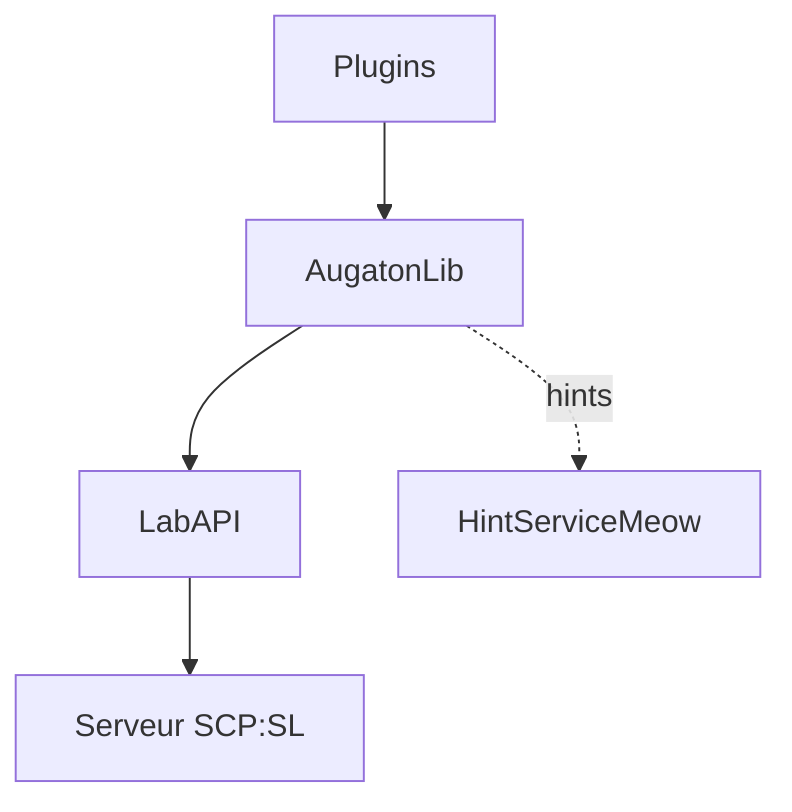

# Augaton SCP:SL Plugins

Quinze plugins de gameplay et une bibliothèque partagée pour **SCP: Secret Laboratory**, conçus pour tourner ensemble sur le même serveur. Ils sont développés pour la communauté francophone **Zone-Shilari** et construits sur [LabAPI](https://github.com/northwood-studios/LabAPI), le framework officiel du jeu.

[](https://github.com/Augaton/augatonscpslplugin/actions/workflows/ci.yml)


> [!WARNING]
> **Pré-version.** La collection vient d'être portée d'EXILED vers LabAPI. Elle compile contre le build public du jeu et ses tests automatisés passent, mais elle n'a pas encore été validée sur un serveur en conditions réelles. La liste des vérifications restantes est dans [TESTS-EN-JEU.md](TESTS-EN-JEU.md).

## Sommaire

- [Points forts](#points-forts)
- [Plugins](#plugins)
- [Plugins tiers](#plugins-tiers)
- [Installation](#installation)
- [Configuration](#configuration)
- [Commandes](#commandes)
- [Architecture](#architecture)
- [Développement](#développement)
- [Migration depuis EXILED](#migration-depuis-exiled)
- [Crédits et licences](#crédits-et-licences)
- [Contribuer](#contribuer)

## Points forts

- **Une collection cohérente.** Des plugins qui touchent à la même ressource peuvent se contredire : l'un éteint les lumières pendant qu'un autre les rallume. Ici, les ressources partagées passent par des arbitres communs.
- **À la carte.** Chaque plugin fonctionne seul avec AugatonLib. Installés ensemble, ils se complètent ; absent, un plugin ne désactive que la synergie concernée.
- **100 % LabAPI.** Aucune dépendance à EXILED, et aucun patch Harmony dans les plugins de la collection.
- **Sobre en ressources.** Le serveur tourne sur une boucle Unity à un seul thread, donc le code évite les allocations et les boucles coûteuses dans les chemins fréquents.
- **Configurable.** Chaque plugin a sa config YAML commentée, ses textes séparés dans une traduction et un rechargement à chaud.
- **Sécurisé.** Permissions vérifiées en premier, arguments bornés, actions du staff tracées, et texte des joueurs assaini avant affichage.

## Plugins

| Plugin | Version | Rôle |
|---|---|---|
| [AugatonLib](AugatonLib) | 2.1.0 | Bibliothèque partagée, **obligatoire** |
| [ChaosDirector](plugins/ChaosDirector) | 1.0.0 | Niveau de chaos commun, nourri par les événements du round |
| [AutoFFToggle](plugins/AutoFFToggle) | 3.0.0 | Coupe le tir allié pendant le round et le réactive à la fin |
| [BetterCoinflipsRewritten](plugins/BetterCoinflipsRewritten) | 3.0.0 | Pile ou face aux effets positifs et négatifs, avec des pièces qui reviennent en cours de round |
| [RandomGamemode](plugins/RandomGamemode) | 4.0.0 | 17 modes de jeu spéciaux, avec vote des joueurs |
| [RoundRecap](plugins/RoundRecap) | 1.0.0 | Bilan de fin de round |
| [RealisticSizes](plugins/RealisticSizes) | 5.0.0 | Taille variable par joueur, avec effets de gameplay en option |
| [RemoteKeycard](plugins/RemoteKeycard) | 5.0.0 | Utilise une carte d'accès sans la sortir de l'inventaire |
| [Replacer](plugins/Replacer) | 3.0.0 | Remplace un joueur parti par un spectateur, avec son état complet |
| [SCP1162](plugins/SCP1162) | 3.0.0 | Le trou dans le mur : échange un objet contre un autre |
| [SCP500s](plugins/SCP500s) | 7.0.0 | 44 pilules personnalisées, dont une roulette, renouvelées de plus en plus vite au fil du round |
| [ScpProximityChat](plugins/ScpProximityChat) | 3.0.0 | Permet aux SCP de parler aux joueurs proches |
| [SCPReplacer](plugins/SCPReplacer) | 3.0.0 | Loterie de volontaires pour reprendre un SCP parti |
| [SiteIncidents](plugins/SiteIncidents) | 1.0.0 | Pannes, alertes et portes bloquées au hasard |
| [SupplyDrop](plugins/SupplyDrop) | 5.0.0 | Largages de ravitaillement, sur minuteur ou événement |
| [TeamGenocide](plugins/TeamGenocide) | 4.0.0 | Annonces C.A.S.S.I.E à l'extinction d'une équipe |

Chaque plugin a son propre README, avec le détail de sa configuration.

## Plugins tiers

Ces plugins viennent d'autres auteurs. Ils restent optionnels, et la bannière de démarrage signale ceux qui sont installés.

| Plugin | Rôle | Installation |
|---|---|---|
| [FairScpSelection](https://github.com/CosmosZvezdo4kin/FairScpSelection) | Choix des SCP selon les préférences des joueurs | **Inclus**, voir [third_party](third_party/FairScpSelection/NOTICE.md) |
| [AntiSLCrush](https://github.com/ui2506/AntiSLCrush) | Protège le serveur contre certains crashs | À installer depuis ses releases. Sa licence interdit tout usage commercial |
| [Better3114Spawn](https://github.com/tayjay/Better3114Spawn) | Fait démarrer SCP-3114 déguisé parmi les humains | À installer depuis ses releases. Lié à l'événement d'Halloween du jeu |

Seul FairScpSelection est redistribué ici, car sa licence le permet. Les deux autres ne sont pas copiés dans ce dépôt : leur code reste chez leurs auteurs, sous leurs propres conditions.

FairScpSelection remplace le choix des SCP du jeu : sa cohabitation avec Better3114Spawn n'a pas été vérifiée.

## Installation

### Prérequis

- Un serveur dédié SCP: Secret Laboratory. LabAPI est inclus avec le jeu.
- [HintServiceMeow](https://github.com/MeowServer/HintServiceMeow) et Harmony, **obligatoires** et inclus dans l'archive. HintServiceMeow affiche tous les hints de la collection sans qu'ils s'écrasent.

### Compiler

Il faut le [SDK .NET 10](https://dot.net), ainsi que `curl` et `unzip` sous Linux.

```bash
git clone https://github.com/Augaton/augatonscpslplugin.git
cd augatonscpslplugin
./tools/fetch-references.sh
dotnet build -c Release
./tools/package.sh
```

`fetch-references.sh` télécharge les assemblies du jeu dans `.references/`. Elles servent uniquement à la compilation et ne sont ni versionnées ni déployées. Pour compiler contre votre propre serveur, définissez plutôt `SL_REFERENCES` vers son dossier `SCPSL_Data/Managed`. FairScpSelection a besoin de `Assembly-CSharp-Publicized.dll`, présent uniquement dans `.references/` : retirez-le de la solution si vous compilez contre un serveur.

Les fichiers compilés arrivent dans `out/`, et `package.sh` les assemble dans `out/zone-shilari-labapi.zip`. Quand une version sera publiée, la même archive sera disponible dans [Releases](https://github.com/Augaton/augatonscpslplugin/releases).

### Déployer

Le dossier `LabAPI` se trouve ici :

| Système | Emplacement |
|---|---|
| Linux | `~/.config/SCP Secret Laboratory/LabAPI/` |
| Windows | `%appdata%\SCP Secret Laboratory\LabAPI\` |
| Panel (Pelican, Pterodactyl) | en général `/home/container/.config/SCP Secret Laboratory/LabAPI/` |

1. Extrayez `zone-shilari-labapi.zip` dans ce dossier. Vous obtenez :

   ```
   LabAPI/
   ├── plugins/global/*.dll                  plugins et HintServiceMeow
   ├── dependencies/global/AugatonLib.dll
   ├── dependencies/global/0Harmony.dll
   └── licenses/                             licences des composants tiers
   ```

2. Redémarrez le serveur. La console affiche une bannière AugatonLib avec les plugins enregistrés, les intégrations détectées et les éventuels conflits.

Pour viser un seul serveur, remplacez `global` par son port.

### Installer à la carte

Rien n'oblige à tout prendre. Chaque plugin fonctionne seul avec ses trois dépendances obligatoires : `AugatonLib.dll` et `0Harmony.dll` dans `dependencies/`, et `HintServiceMeow.dll` dans `plugins/`. Gardez uniquement les DLL qui vous intéressent, ou téléchargez-les une par une depuis une release. Un plugin absent ne désactive que la synergie concernée. Par exemple, SupplyDrop continue de larguer sans SCP500s, simplement sans pilules.

## Configuration

Les fichiers sont créés au premier démarrage, dans `LabAPI/configs/<port>/<Plugin>/` :

| Fichier | Contenu |
|---|---|
| `config.yml` | Réglages du plugin, avec une description pour chaque clé |
| `translation.yml` | Textes affichés aux joueurs, pour les plugins qui en ont |
| `properties.yml` | Activation ou désactivation du plugin, géré par LabAPI |

Appliquez vos changements à chaud avec `labapi reload configs`. Les permissions du staff se règlent dans `LabAPI/configs/permissions.yml`.

## Commandes

### Joueurs

À taper dans la console du jeu (touche `~`).

| Commande | Plugin | Effet |
|---|---|---|
| `.noreplace` (`.nr`) | Replacer | Refuse ou accepte d'être choisi comme remplaçant pendant le round |
| `.votemode [numéro]` (`.vm`) | RandomGamemode | Affiche les choix ou vote pour le prochain mode de jeu |
| `.volunteer [numéro]` (`.v`) | SCPReplacer | Se porte volontaire pour reprendre un SCP parti |
| `.human` | SCPReplacer | Renonce à son rôle de SCP en début de round |

### Staff

Disponibles dans le Remote Admin et la console du serveur. Sans argument, une commande liste ses sous-commandes.

| Commande | Alias | Permission | Sous-commandes principales |
|---|---|---|---|
| `autoff` | `ff` | `autofftoggle.manage` | `status`, `set` |
| `chaos` | `chaosdirector` | `chaosdirector.manage` | `status` |
| `coinflip` | `bcf` | `bettercoinflips.manage` | `status` |
| `gamemode` | `gm` | `randomgamemode.manage` | `list`, `force`, `start`, `stop` |
| `incidents` | `inc` | `siteincidents.manage` | `status`, `trigger` |
| `sizes` | `rsize` | `realisticsizes.manage` | `status`, `reset` |
| `remotekeycard` | `rk` | `remotekeycard.manage` | `status` |
| `replacer` | `rep` | `replacer.manage` | `status` |
| `scp1162` | `1162` | `scp1162.manage` | `status`, `spawn`, `despawn` |
| `scp500` | `pills` | `scp500s.give` | `list`, `give` |
| `scpproximity` | `prox` | `scpproximitychat.manage` | `status` |
| `scpreplacer` | `scprep` | `scpreplacer.manage` | `status` |
| `supplydrop` | `sd` | `supplydrop.call` | `list`, `call` |
| `teamgenocide` | `tg` | `teamgenocide.manage` | `status` |

La sous-commande `collection` affiche l'état de toute la collection : plugins chargés, intégrations et arbitres.

## Architecture



Les plugins ne se référencent jamais entre eux. Ils partagent AugatonLib, qui fournit :

| Service | Rôle |
|---|---|
| Arbitres | Départagent les plugins qui écrivent la même ressource |
| `PluginBus` | Fait communiquer les plugins sans dépendance directe |
| `PlayerDeparture` | Signale un départ tant que l'état du joueur est encore lisible |
| `HintChannel` | Donne à chaque plugin son canal de hints |
| `Escalation`, `LootSpots` | Font monter le chaos par paliers et réapparaître des objets à des endroits sûrs |
| `StaffCommand` | Socle commun : permission, bornage des arguments, audit |
| `SafeText` | Assainit tout texte venant d'un joueur |

Six ressources sont arbitrées, et une pause commune suspend largages, pilules, pièces et incidents pendant les modes de type arène :

| Ressource | Arbitre |
|---|---|
| Tir allié | `FriendlyFireArbiter` |
| Taille du joueur | `ScaleArbiter` |
| Lumières et teintes | `LightArbiter` |
| Portes verrouillées | `DoorLockRegistry` |
| Départ d'un joueur | `DepartureArbiter` |
| Annonces d'extinction | `GenocideArbiter` |

Le bus sert par exemple à SupplyDrop pour demander des pilules à SCP500s, ou à SCPReplacer pour faire patienter TeamGenocide : le dernier SCP qui part n'est pas annoncé comme éliminé tant qu'un volontaire peut le reprendre.

| Si... | Alors |
|---|---|
| RandomGamemode est présent | Les modes arène suspendent largages, pilules, pièces et incidents |
| Replacer et RealisticSizes sont présents | Le remplaçant garde la taille du joueur parti |
| SCP500s et SupplyDrop sont présents | Les largages contiennent des pilules |
| SCP500s et RandomGamemode sont présents | Soirée pilules distribue les vraies pilules |
| ChaosDirector est présent | Les pilules, pièces et incidents s'accélèrent avec l'agitation du round |
| RoundRecap est présent | Le bilan compte ce que font les autres plugins |
| Un plugin manque | Seule la synergie concernée disparaît |

Une CI vérifie qu'aucun plugin n'en référence un autre.

Le détail est dans le [README d'AugatonLib](AugatonLib/README.md).

## Développement

### Structure

```
AugatonLib/            bibliothèque partagée
plugins/<Nom>/         un dossier par plugin
third_party/           plugins d'autres auteurs, code inchangé
tests/                 tests automatisés
tools/                 récupération des références et assemblage de l'archive
```

`Directory.Build.props` et `Directory.Build.targets` portent toute la configuration commune : un `.csproj` de plugin ne déclare que son espace de noms et sa version.

### Compiler et tester

```bash
dotnet build -c Release
dotnet test tests/AugatonLib.Tests -c Release
```

Les tests tournent sans le jeu : ils couvrent la logique indépendante d'Unity, comme `SafeText`, `PluginBus`, l'urne de vote ou les paliers de chaos. Le reste se valide sur un serveur.

### Ajouter un plugin

1. Créez `plugins/<Nom>/<Nom>.csproj`, avec seulement `RootNamespace` et `Version`.
2. Créez une classe qui hérite de `AugatonPlugin<Config, Translation>`, ou de `AugatonPlugin<Config>` s'il n'a aucun texte.
3. Déclarez ses capacités avec `PluginDirectory.Register`, et retirez-les dans `Disable`.
4. Ajoutez-le au catalogue dans `AugatonLib/Runtime/KnownPlugin.cs`. Un test vérifie que chaque dossier de plugin y figure.
5. Ajoutez le projet à `augatonscpslplugin.slnx`.

Les conventions du projet sont dans [CLAUDE.md](CLAUDE.md).

### Intégration continue

| Workflow | Déclencheur | Effet |
|---|---|---|
| `ci` | push sur `main`, pull request | Compile, teste, produit l'archive et cherche des secrets avec gitleaks |
| `release` | tag `v*` | Compile, teste et publie l'archive dans une release GitHub |

## Migration depuis EXILED

Les configs EXILED ne se reprennent pas telles quelles :

- Le dossier change : elles vivent maintenant dans `LabAPI/configs/<port>/<Plugin>/`.
- `is_enabled` disparaît au profit de `properties.yml`.
- Les valeurs `ZoneType`, `RoomType` et `EffectType` changent de noms.

Pensez à retirer les anciennes DLL de `.config/EXILED/Plugins/`, sinon les deux versions tourneraient en parallèle. Les changements propres à chaque plugin figurent dans son README.

## Crédits et licences

Les plugins portés sont des réécritures. Leur conception et leurs mécaniques reviennent à leurs auteurs d'origine, cités en jeu dans le champ `Author` de chaque plugin.

| Composant | Auteur(s) d'origine | Licence |
|---|---|---|
| AugatonLib, tests et outillage | Augaton | [MIT](LICENSE) |
| ChaosDirector, RoundRecap, SiteIncidents | Augaton | [MIT](plugins/ChaosDirector/LICENSE) |
| AutoFFToggle | Kognity | [MIT](plugins/AutoFFToggle/LICENSE) |
| BetterCoinflipsRewritten | Mikihero, Matisiowy | [Non précisée](plugins/BetterCoinflipsRewritten/NOTICE.md) |
| RandomGamemode | OPGman | [MIT](plugins/RandomGamemode/LICENSE) |
| RealisticSizes | JesusQC | [Non précisée](plugins/RealisticSizes/NOTICE.md) |
| RemoteKeycard | Beryl | [Non précisée](plugins/RemoteKeycard/NOTICE.md) |
| Replacer | DGvagabond | [Non précisée](plugins/Replacer/NOTICE.md) |
| SCP1162 | [MrAfitol](https://github.com/MrAfitol/SCP-1162), d'après le [plugin Synapse](https://github.com/SynapseSL/Scp1162) | [Non précisée](plugins/SCP1162/NOTICE.md) |
| SCP500s | VividZap, Lumi | [MIT](plugins/SCP500s/LICENSE) |
| ScpProximityChat | Bolton | [Non précisée](plugins/ScpProximityChat/NOTICE.md) |
| SCPReplacer | Jon M | [Non précisée](plugins/SCPReplacer/NOTICE.md) |
| SupplyDrop | Wafel, KadeDev, JesusQC | [Non précisée](plugins/SupplyDrop/NOTICE.md) |
| TeamGenocide | Heisenberg3666 | [MIT](plugins/TeamGenocide/LICENSE) |
| FairScpSelection | CosmosZvezdochkin | [Apache 2.0](third_party/FairScpSelection/LICENSE.txt) |
| HintServiceMeow, inclus dans l'archive | MeowServer | [MIT](third_party/licenses/HintServiceMeow-LICENSE.txt) |
| Harmony, inclus dans l'archive | Andreas Pardeike | [MIT](third_party/licenses/Harmony-LICENSE.txt) |

« Non précisée » signifie qu'aucun fichier de licence n'accompagnait les sources d'origine. Ce dépôt n'accorde alors aucun droit supplémentaire sur ces plugins : ils sont publiés comme travaux dérivés à des fins communautaires, avec attribution. La licence MIT du dépôt ne s'y applique pas.

**Auteurs d'origine :** si vous souhaitez qu'un plugin soit retiré, renommé ou placé sous une autre licence, ouvrez une [issue](https://github.com/Augaton/augatonscpslplugin/issues). Nous donnerons suite sans discussion.

Ce projet n'est pas affilié à Northwood Studios.

## Contribuer

Les retours sont les bienvenus, en particulier sur les points de [TESTS-EN-JEU.md](TESTS-EN-JEU.md).

- **Bug :** ouvrez une [issue](https://github.com/Augaton/augatonscpslplugin/issues) avec la version du jeu, le plugin concerné et l'erreur de la console.
- **Code :** ouvrez une pull request. La CI doit passer, et tout `+=` sur un event dans `Enable` a besoin de son `-=` dans `Disable`.
